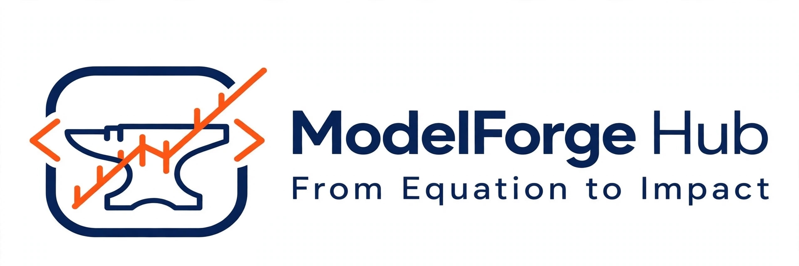

  

<h1 align="center">🌌 ModelForge Hub - KZN Solar & Binary Star Systems</h1>

### UniZulu BSc Final Year Project | Applied Maths & Physics / CS
**Authors:** Ntusani Mongwe & Nontando Tsewu

A unified hub bridging solar engineering and astrophysics for KZN's 32 nodes.

---

### 🌐 Live Apps

| App | Status | What it does |
|---|---|---|
| **App 1: KZN Solar Optimizer V1.0** | ✅ Live `app.py` | Real-world: NASA GHI for 32 KZN towns, optimal tilt = |lat| + dec*0.5, fixed vs adjustable yield. |
| **App 2: KZN Binary Solar Model V1.1** | ✅ Live `app_binary_solar.py` | Hypothetical: What if KZN had two suns? Uses L=4πR²σT⁴ to simulate GHI boost (+8% to +250%) and tilt shift. Inspired by Kepler-16b. |
| **App 3: Binary Star Lab V2.0** | 🔨 In Progress `app_binary_lab.py` | Pure astrophysics: Kepler's 3rd Law P²=a³/(M1+M2), barycenter, orbital animation, light curves, habitable zone. |

> **Disclaimer App 2:** Earth has ONE Sun. App 2 is an educational "what-if" simulator, not a claim of reality.

---

### 🔬 Physics Behind the Hub

- **App 1:** Solar geometry, NASA POWER climatology
- **App 2:** Stefan-Boltzmann Law L=4πR²σT⁴, binary irradiance superposition
- **App 3:** Newtonian gravity, Kepler's Laws, Roche limit, radiative habitable zones

---

### 🗺️ Roadmap - What Comes After?

This hub is designed as a 6-hexagon system:

- **Hex 1-3 DONE:** Solar, Binary Solar, Binary Lab
- **Hex 4 NEXT: Battery + Load Model (Idea 4)** - Add JoJo tank, lights, fridge load profile for rural KZN. Calculate autonomy days, battery size, load shedding resilience.
- **Hex 5 FUTURE: Cost & Payback Model** - R/kWh, Eskom tariffs, payback period, carbon credits for 32 towns.
- **Hex 6 FUTURE: IoT Live Dashboard** - Connect to ESP32 + INA219 sensor, stream real panel data to compare with NASA predicted.

**Vision:** One KZN portal where a learner can go from "What is my optimal tilt?" to "What if we orbited two stars?" to "How long will my battery last during load shedding?" - all with same 32 nodes.

---

### 👩‍💻 For Developers

Single repo, multiple Streamlit apps. Each app is a separate deployment with different main file:
- `app.py` → kznsolar
- `app_binary_solar.py` → kznbinarysolar
- `app_binary_lab.py` → kznbinarystars

Requirements: `streamlit, requests, matplotlib`

---

© 2026 ModelForge Hub | University of Zululand
